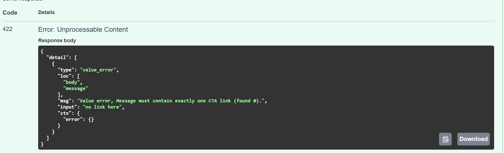
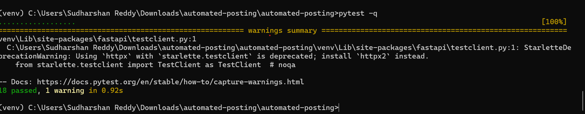
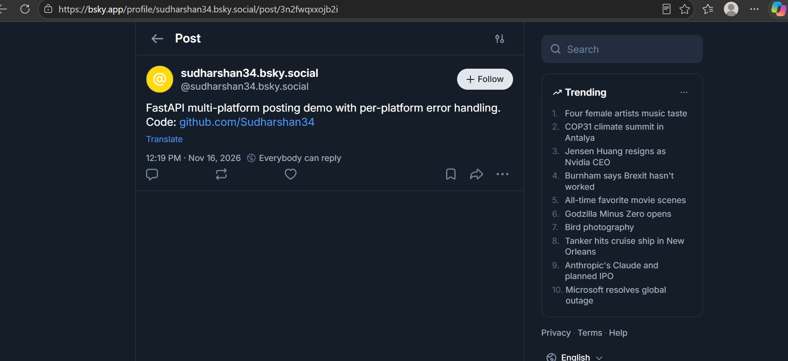
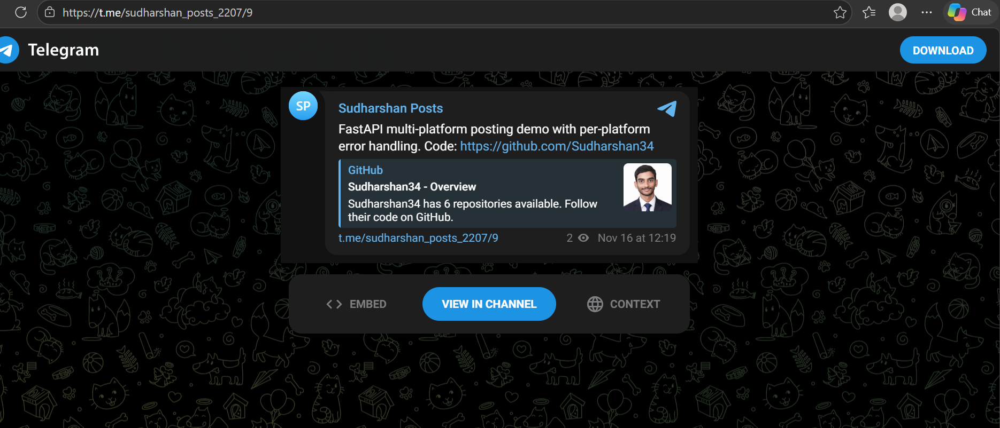
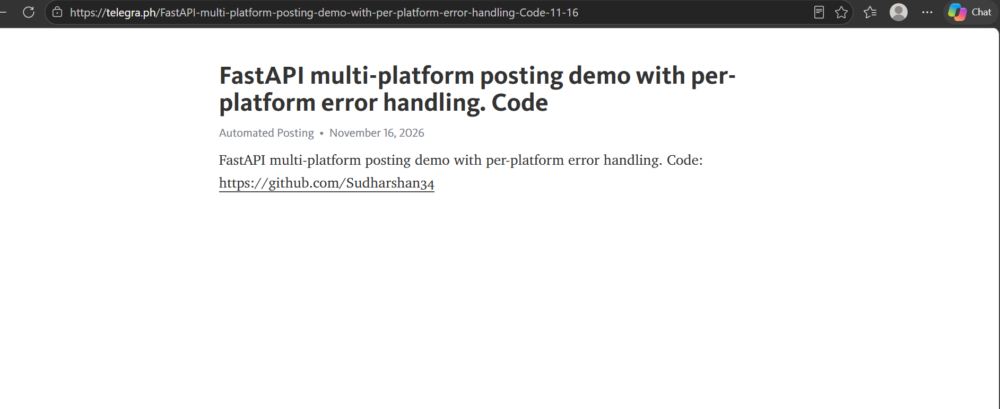
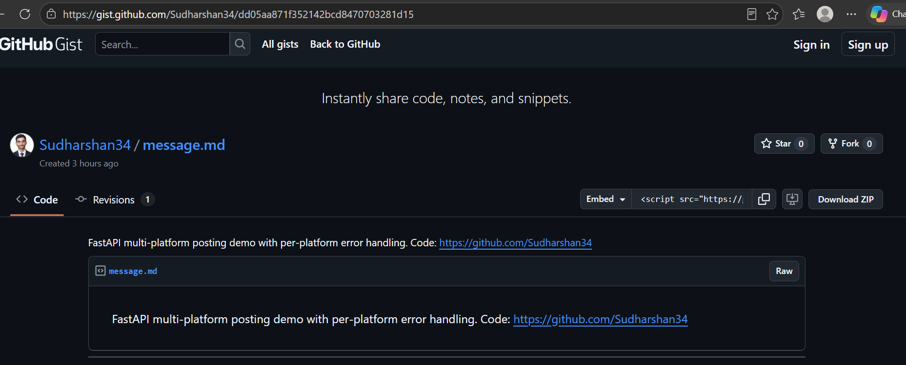
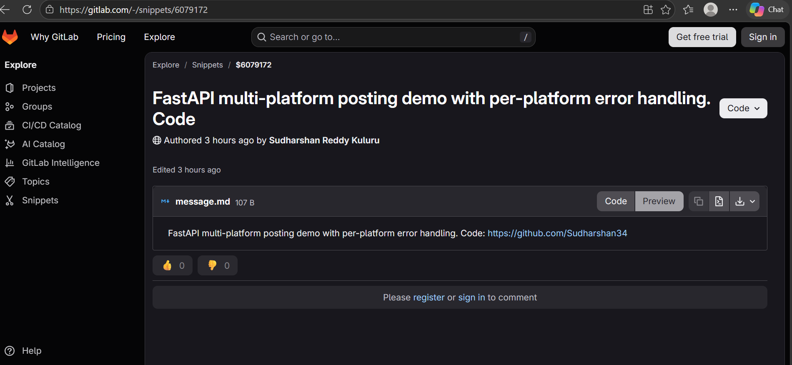

# Automated Multi-Platform Posting System

A FastAPI service that publishes one short message (containing exactly one CTA link) to several third-party platforms through their official APIs, then returns a per-platform result. A failure on one platform never stops the others.

**Status of the 7 integrations (last live run: 16 Nov 2026)**

| Platform | Result | Notes |
|---|---|---|
| Bluesky | Success, public | |
| Telegram (public channel) | Success, public | |
| Telegraph | Success, public | |
| GitHub Gist | Success, public | |
| GitLab Snippets | Success, public | |
| Mastodon | Failed (HTTP 403) | Worked in earlier runs; mastodon.social later disabled the test account (see Known limitations) |
| Dev.to | Failed (HTTP 401) | Worked in earlier runs; the test account was later flagged (see Known limitations) |

## API

`POST /posting` on port 4000.

Validation (HTTP 422 on failure): message must be non-empty, at most 200 characters, and contain exactly one valid http(s) link.

### Request
```bash
curl -X POST http://localhost:4000/posting \
  -H "Content-Type: application/json" \
  -d '{"message": "FastAPI multi-platform posting demo with per-platform error handling. Code: https://github.com/Sudharshan34"}'
```

### Response (real output, shortened to 3 of 7 platforms)
```json
{
  "success": true,
  "results": [
    {"platform": "Mastodon", "status": "failed", "posted_url": null, "public_access": false, "date": null, "time": null,
     "error": "HTTP 403: {\"error\":\"Your login is currently disabled\"}"},
    {"platform": "Bluesky", "status": "success",
     "posted_url": "https://bsky.app/profile/sudharshan34.bsky.social/post/3n2fwqxxojb2i",
     "public_access": true, "date": "2026-11-16", "time": "12:19:28", "error": null},
    {"platform": "GitHub Gist", "status": "success",
     "posted_url": "https://gist.github.com/Sudharshan34/dd05aa871f352142bcd8470703281d15",
     "public_access": true, "date": "2026-11-16", "time": "12:19:29", "error": null}
  ]
}
```
The complete 7-platform response is in [`screenshots/sample-response.json`](screenshots/sample-response.json). `success` is `true` when at least one platform succeeded.

### Validation error
```json
{"detail":[{"type":"value_error","loc":["body","message"],"msg":"Value error, Message must contain exactly one CTA link (found 0).","input":"no link here"}]}
```

## Platforms and APIs

| Platform | API used | Credential |
|---|---|---|
| Mastodon | `POST /api/v1/statuses` | Access token |
| Bluesky | AT Protocol `createSession` + `createRecord` | App password |
| Dev.to | Forem `POST /api/articles` | API key |
| Telegram | Bot API `sendMessage` to a public channel | Bot token |
| Telegraph | `createPage` | Access token |
| GitHub Gist | `POST /gists` (public) | Token with `gist` scope |
| GitLab Snippets | `POST /api/v4/snippets` (public) | Token with `api` scope |

Platform selection is internal; the caller only sends `message`. Credentials come only from environment variables (`.env`, git-ignored). See `.env.example`.

## Project structure
```
app/
  main.py                      FastAPI app, POST /posting
  schemas.py                   Pydantic models + validation
  config.py                    Env-based settings
  platforms/                   base.py + one module per platform
  services/posting_service.py  Concurrent fan-out, error isolation, retries
tests/test_posting.py          18 tests (no network)
screenshots/                   Evidence of a live run
```

## Setup
```bash
python -m venv venv
venv\Scripts\activate          # Mac/Linux: source venv/bin/activate
pip install -r requirements.txt
copy .env.example .env         # Mac/Linux: cp .env.example .env  (then fill in tokens)
uvicorn app.main:app --host 0.0.0.0 --port 4000
```
Swagger UI: http://localhost:4000/docs

### Getting credentials
- **Mastodon**: Preferences > Development > New application (scope `write:statuses`).
- **Bluesky**: Settings > Privacy and security > App passwords.
- **Dev.to**: Settings > Extensions > Generate API key.
- **Telegram**: create a bot with @BotFather, create a **public** channel, add the bot as admin, set `TELEGRAM_CHANNEL=@yourchannel`.
- **Telegraph**: open `https://api.telegra.ph/createAccount?short_name=poster&author_name=poster` and copy `access_token`.
- **GitLab Snippets**: gitlab.com > Preferences > Access tokens > legacy token, scope `api`.
- **GitHub Gist**: github.com/settings/tokens > classic token, scope `gist`.

A platform with missing credentials is reported as `failed` with the missing variable names; the others still run.

## Design notes
- Platforms run **concurrently** (`asyncio.gather`). Each call is wrapped so any exception (HTTP error, timeout, bad response, missing config) becomes a `failed` result without affecting the others.
- Connection failures that happen before a request is sent are retried (up to 2 times); nothing else is retried, so a retry cannot create a duplicate post.
- `public_access` is verified without authentication (the posted page, or the platform's public API where the page blocks scripted requests), with a few short retries because new posts can take a moment to appear.
- Hashnode and Write.as were evaluated but are **not registered**: Hashnode's GraphQL API now requires a paid plan, and Write.as's spam filter blocks anonymous posts containing links (it returns a placeholder id, which the code reports as a failure). Their modules are kept in `app/platforms/` for reference.

## Known limitations
- **Mastodon and Dev.to test accounts were restricted** by the platforms' anti-spam systems after repeated test posts with near-identical text from newly created accounts. Both integrations worked in earlier runs (the first run of the day, before the restrictions); the current errors come from the account state, not the code. With an account in good standing, they post normally.
- Posting is not idempotent: sending the same message twice creates two posts.
- Telegram requires the bot to be an admin of a **public** channel to produce a public post URL.

## Tests
```bash
pytest -q
```
Covers input validation, failure isolation, connection retry, per-platform request building (mocked HTTP), and public-access verification. No network access needed.

## Screenshots
Located in `screenshots/`:
- `01*-swagger-response*.png` and `sample-response.json`: full 7-platform response
- 
- 
- 
- 
- 
- 
- 
